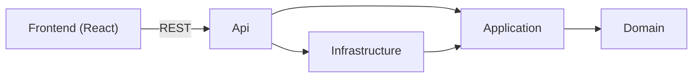

# LexBank

Web application that normalizes heterogeneous Spanish bank statements into a common schema and categorizes their transactions with a deterministic rules engine.

## Academic context

| | |
|---|---|
| **Work** | Master's Thesis (*Trabajo Final de Máster*, TFM) |
| **Degree** | Master's degree in Computer Engineering |
| **University** | Universitat Oberta de Catalunya (UOC) |
| **Area** | Web development |
| **Author** | José Ramón Rodríguez Hernández ([@Serah73](https://github.com/Serah73)) |

**Thesis title:** *Design and development of a web application for the normalization and integration of heterogeneous Spanish bank statements and their automatic categorization through a deterministic rules engine.*

## Abstract

Spanish banks export account statements in formats that differ in file type, column layout, header naming and number and date conventions. This heterogeneity makes it hard for a household to review its finances across several banks with a single tool.

LexBank addresses the problem in two steps. First, it imports the statements and normalizes them into a common, bank-independent schema (date, description, amount, balance). Second, it assigns each transaction a category (for example groceries, leisure or health) through a deterministic, keyword-based rules engine.

The system deliberately does **not** use artificial intelligence or machine learning for categorization. A deterministic engine makes every decision traceable to the rule that produced it, and reproducible for the same input. Users can correct the assigned categories; those corrections refine the rule set and provide the data needed to measure the engine's accuracy.

## Objectives

1. Import bank statements exported by Spanish banks in the formats they offer (XLSX, CSV, PDF).
2. Detect and map each bank's headers to the common schema, with manual mapping as a fallback.
3. Categorize transactions automatically with a deterministic rules engine.
4. Let users review and correct categories, and derive new rules from those corrections.
5. Measure the accuracy of the engine from the users' corrections.

## Scope and design decisions

- **Intended use:** family use, run locally; it is not designed as a public service.
- **Users:** several users with email and password sign-up; each user sees only their own data. There are no roles.
- **Shared knowledge:** categories and rules are common to all users; rules created from corrections join the common set.
- **Currency:** every amount is in EUR; there is no multi-currency support and no conversion.
- **Languages:** the user interface is offered in Spanish (default) and English. The API returns stable codes, never user-facing text; the frontend translates them.
- **Connectivity:** always online; there is no offline mode.

## Architecture

The backend follows Clean Architecture ([ADR-0002](docs/adr/0002-clean-architecture.md)). Dependencies point inwards, so the normalization and categorization logic does not depend on any bank format, database or web framework.



| Layer | Responsibility |
|---|---|
| Domain | Business concepts (for example `Transaction`); references nothing. |
| Application | Use cases and the interfaces they need (statement readers, repositories). |
| Infrastructure | Implementations of those interfaces: bank statement readers, EF Core persistence. |
| Api | REST endpoints and composition root. |

## Technology stack

| Area | Technologies |
|---|---|
| Backend | ASP.NET Core 8, EF Core 8, SQL Server, ClosedXML |
| Frontend | React 19, TypeScript, Vite |
| Frontend (planned) | shadcn/ui, Tailwind CSS, Recharts |
| Testing | xUnit (backend), Vitest and React Testing Library (frontend) |
| Tooling | GitHub Actions, oxlint |

## Repository structure

```
src/backend/      Backend source code (one project per architecture layer)
src/frontend/     Frontend source code
tests/backend/    Backend tests (one project per tested layer)
docs/adr/         Architecture Decision Records
skills/           AI-agent skills (Claude Code) used during development
.github/          CI and release workflows, issue template
```

## Getting started

Requirements: .NET 8 SDK, SQL Server LocalDB (Windows) and Node.js.

```bash
# Backend API, on http://localhost:5236
dotnet run --project src/backend/LexBank.Api --launch-profile http

# Frontend, in another terminal
cd src/frontend
npm install
npm run dev
```

From Git Bash, `./run.sh` starts both in a single terminal.

Detailed instructions for each part:

- [Backend](src/backend/README.md): running the API, database, migrations and tests.
- [Frontend](src/frontend/README.md): development server, tests and build.

## Development methodology

- **Incremental delivery:** the work is split into user stories that cut through every layer (data, backend and user interface), each delivering value on its own.
- **Test-Driven Development:** production code is written only to satisfy a previously failing test (red, green, refactor).
- **Architecture Decision Records:** relevant technical decisions, with their context, alternatives and consequences, are recorded under [`docs/adr`](docs/adr).
- **Branching and continuous integration:** work happens on `develop`; `main` only receives changes through pull requests, which build and test the backend ([ADR-0003](docs/adr/0003-branching-ci-release.md)).
- **AI-assisted development:** Claude Code is used as a pair-programming assistant under the author's direction and review. The skills that define that workflow (`backlog`, `story`, `pair`, `update-docs`) are published under [`skills/`](skills) for transparency.

### Architecture Decision Records

| ADR | Decision |
|---|---|
| [0001](docs/adr/0001-monorepo.md) | Use a monorepo for backend and frontend |
| [0002](docs/adr/0002-clean-architecture.md) | Use Clean Architecture for the backend |
| [0003](docs/adr/0003-branching-ci-release.md) | Branching, CI and release workflow |
| [0004](docs/adr/0004-closedxml-for-xlsx.md) | Use ClosedXML to read XLSX statements |
| [0005](docs/adr/0005-vitest-for-frontend-tests.md) | Use Vitest for frontend tests |
| [0006](docs/adr/0006-localdb-for-database-tests.md) | Test the database layer against SQL Server LocalDB |

## Project status

The project is under active development.

| Capability | Status |
|---|---|
| Import of XLSX statements (Ruralvía) into the common schema | Implemented |
| Report of the rows that could not be read, with their reason | Implemented |
| Persistence of imported transactions | Implemented |
| Skipping of transactions that were already imported | Implemented |
| User accounts and per-user data | Planned |
| Automatic detection of bank and headers; manual mapping | Planned |
| CSV and PDF import | Planned |
| Deterministic categorization engine, corrections and rule management | Planned |
| Accuracy measurement and spending charts | Planned |
| Spanish and English user interface | Planned (Spanish only for now) |
| Visual design with light and dark themes | Planned |

## License

This project is licensed under the [Creative Commons Attribution-NonCommercial-ShareAlike 4.0 International](LICENSE) license (CC BY-NC-SA 4.0).

Third-party code licensed under MIT is acknowledged in [THIRD_PARTY_NOTICES.md](THIRD_PARTY_NOTICES.md).
